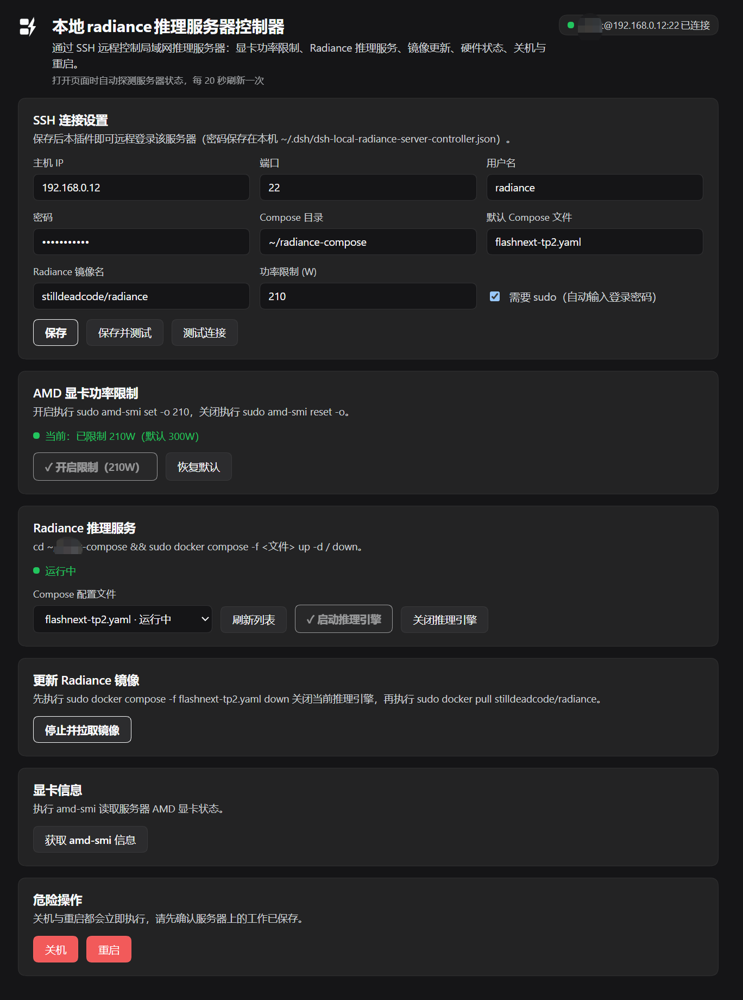
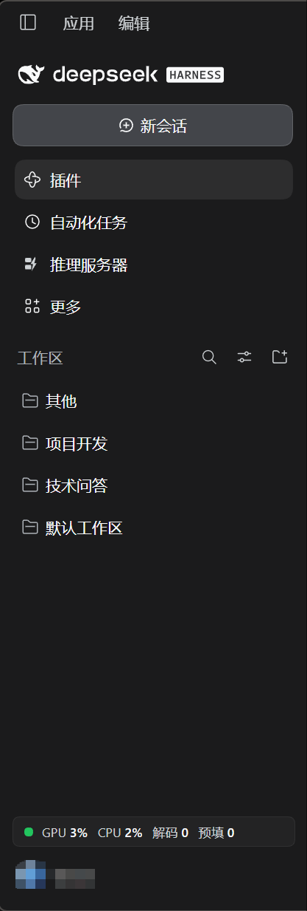

# dsh-local-radiance-server-controller

A [DeepSeek Harness](https://github.com/deepseek-ai) (DSH) plugin: remote-control an AMD inference server on your local LAN over SSH — the local Radiance inference server controller.

Adds a "推理服务器 / Inference Server" panel to the DSH sidebar plus an always-visible live-metrics widget in the sidebar footer, so day-to-day operations need no terminal.

Chinese documentation: [README.zh-CN.md](./README.zh-CN.md)



Sidebar entry and the always-live metrics widget (bottom of the sidebar):



## Features

| Card | What it does | Remote command |
|---|---|---|
| SSH settings | Host / port / username / password / compose directory / default service file / image name / power limit / sudo toggle | — (saved locally to `~/.dsh/dsh-local-radiance-server-controller.json`) |
| AMD GPU power limit | Enable limit / reset to default; shows current limit state; buttons get a ✓ and disable when the state already matches | `sudo amd-smi set -o <W>` / `sudo amd-smi reset -o` |
| Radiance inference service | Dropdown of yaml files in the compose directory (`common.yaml` hidden), start / stop / update image (down first, then pull); shows the running engine version; opens the engine web page in your default browser | `cd <dir> && sudo docker compose -f <file> up -d / down`; `sudo docker pull <image>`; web URL = `http://<host>:<PORT>` with PORT read from `<compose dir>/.env` |
| Server diagnostics | Fetch full amd-smi output | `amd-smi` |
| Danger zone | Shutdown / Reboot — each with its own two-click confirmation (auto-disarms after 4 s) | `sudo shutdown -h now` / `sudo reboot` |
| Sidebar widget | One persistent row: status dot + `GPU %` `CPU %` decode/prefill t/s (shrinks to a status dot when the sidebar is collapsed) | see Live metrics below |

Opening the panel probes the server immediately (running services, power-limit state), then refreshes every 20 s; every action also triggers an immediate refresh.

## Live metrics & connection architecture

The whole plugin keeps exactly **one long-lived SSH connection** to the server (15 s keepalive, self-healing reconnect with backoff). All traffic multiplexes over it through ssh2 exec channels:

| Traffic | Cadence | Remote command |
|---|---|---|
| Engine decode/prefill | 0.5 s | `curl localhost:<PORT>/stats` (radiance Web API; PORT and API key are read on the fly from `<compose dir>/.env` — the key never leaves the server; the `version` field doubles as the engine-version display on the service card) |
| CPU / GPU utilization | 5 s | `/proc/stat` double-sample delta; `GFX_ACTIVITY` from `amd-smi metric -u` |
| Service / power state | 20 s | `docker compose ls --format json`; `amd-smi static -l` (SOCKET vs MAX power to detect an active limit) |
| User actions | on demand | see Features table |

No short-lived connections: the server's `journalctl` typically shows only one or two SSH logins per day.

The sudo password is piped in via base64 (`base64 -d | sudo -S`); plaintext never appears in remote process arguments.

## Installation

### Prerequisites

- This machine: DeepSeek Harness desktop
- Server: sshd with password login, sudo available (Radiance deployed via docker compose; AMD GPU with `amd-smi`; radiance engine exposing the `/stats` endpoint)

### Steps (first install on any machine)

1. **Copy the plugin directory** anywhere on the target machine (do **not** copy `node_modules`; reinstall dependencies per machine):
   You only need `index.js`, `client.js`, `package.json`, `cordis.patch.yml`, `icon.svg`, `locale/` (`assets/` is the README screenshot, optional).
2. **Install dependencies inside the plugin directory** (installing a local directory does not install its dependencies; skipping this fails with `Cannot find package 'node-ssh'`):
   ```bash
   cd <plugin dir>
   npm install --omit=dev
   ```
3. **Install the bundle into DSH**: tell the Harness agent
   > use plugin_manager to install `<absolute plugin dir>` as a bundle
   
   or run `dsh plugin install <absolute plugin dir>`.
4. **Restart the DSH app** (Host-side code loads at app start).
5. Open the sidebar panel, fill in the SSH details, save.

To sync between machines, copy the files listed in step 1 and repeat steps 2–3.

## Configuration

| Field | Notes | Default |
|---|---|---|
| Host / port / username / password | SSH login (the password is also used for sudo) | `22` |
| Compose directory | Directory containing the service yaml files (`~` allowed) | `~/radiance-compose` |
| Default compose file | Preselected service file in the panel | `flashnext-tp2.yaml` |
| Radiance image | Image pulled by the Update-image action | `stilldeadcode/radiance` |
| Power limit (W) | Target watts for the Enable-limit action | `210` |
| Use sudo | When off, commands run without sudo (the remote user needs direct docker/AMD permissions) | on |

> ⚠️ Security: the SSH password is stored **in plaintext** on this machine at `~/.dsh/dsh-local-radiance-server-controller.json`. Don't use this on shared/managed machines, and keep the account's permissions minimal.

## Troubleshooting

| Symptom | Fix |
|---|---|
| Errors or stale behavior after code edits | Restart the DSH app (Host module cache) |
| `sudo: a password is required` | Re-save the password in the panel (sudo uses the login password) |
| Widget shows `-` although the service is fine | Normal during the reconnect cooldown after a server reboot/disconnect; recovers within ~30 s |
| A yaml file missing from the dropdown | Only plain `.yaml/.yml` file names without `..` are listed; `common.yaml` is hidden on purpose |
| Decode reads 0/tiny while idle | Radiance reports a windowed engine-side average; idle is near zero by design |

## File structure

```
dsh-local-radiance-server-controller/
├── index.js          # Host half: HTTP endpoints + SSH connection pool + all remote actions
├── client.js         # Client half: panel UI + sidebar icon + live metrics widget
├── cordis.patch.yml  # Loader patch (injects the plugin entry)
├── icon.svg          # App icon
├── assets/           # README screenshots (screenshot.png, sidebar.png)
├── locale/{zh,en}.json
└── package.json      # dsh.bundle / dsh.client manifest; depends on node-ssh
```

Host endpoints (prefix route on the local DSH web server, protected by DSH login):
`GET state`, `GET job?id`, `GET fast`, `POST settings`, `POST action {action,file?}`
under `/dsh-local-radiance-server-controller`.

## License

MIT — see [LICENSE](./LICENSE).
