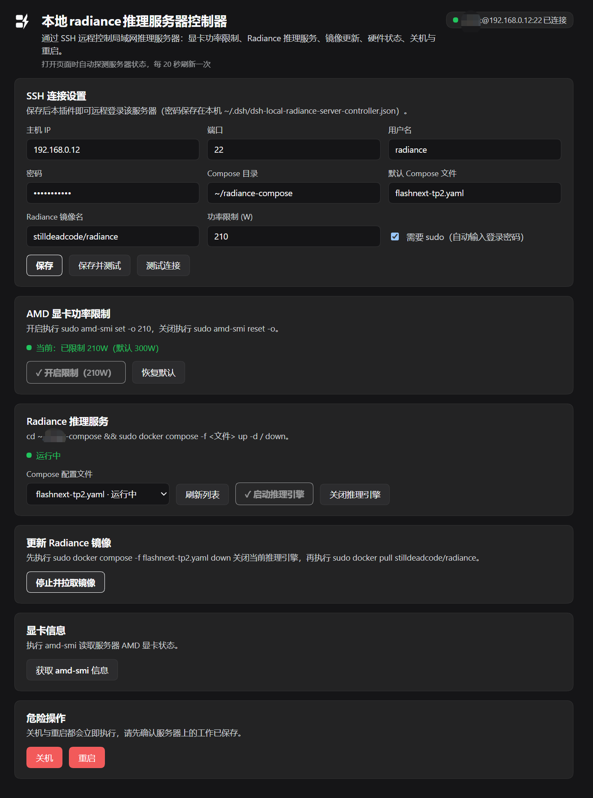
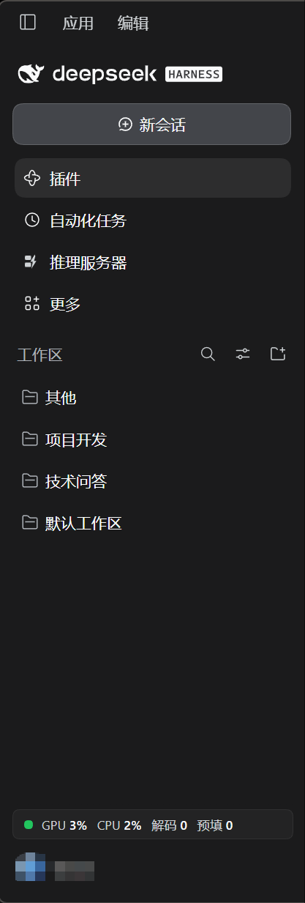

# dsh-local-radiance-server-controller

DeepSeek Harness（DSH）插件：通过 SSH 远程控制局域网内的 AMD 推理服务器（本地 Radiance 推理服务器控制器）。

在 DSH 侧边栏提供「推理服务器」面板 + 侧栏底部常驻实时指标小部件，无需打开终端即可完成日常运维。

English documentation: [README.md](./README.md)



侧栏入口与常驻实时指标小部件（位于侧栏底部）：



## 功能

| 卡片 | 能力 | 远端实际执行 |
|---|---|---|
| SSH 连接设置 | 主机 / 端口 / 用户名 / 密码 / Compose 目录 / 默认服务文件 / 镜像名 / 功率值 / 是否 sudo | —（保存到本机 `~/.dsh/dsh-local-radiance-server-controller.json`） |
| AMD 显卡功率限制 | 开启限制 / 恢复默认，显示当前限制状态，按钮按实际状态打 ✓ 置灰 | `sudo amd-smi set -o <W>` / `sudo amd-smi reset -o` |
| Radiance 推理服务 | 下拉列出 Compose 目录下的 yaml（自动隐藏 `common.yaml`），启动 / 关闭 / 更新镜像（先 down 再 pull） | `cd <dir> && sudo docker compose -f <file> up -d / down`；`sudo docker pull <image>` |
| 服务器诊断 | 拉取 amd-smi 完整输出 | `amd-smi` |
| 危险操作 | 关机 / 重启（均为独立二次确认，4 秒超时自动解除） | `sudo shutdown -h now` / `sudo reboot` |
| 侧栏小部件 | 常驻一行：状态灯 + `GPU %` `CPU %` `解码 t/s` `预填 t/s`（侧栏收起时缩为状态圆点） | 见下方「实时指标」 |

打开面板即自动探测服务器状态（服务在跑与否、功率限制现状），此后每 20 秒刷新；执行任何操作后立即刷新。

## 实时指标与连接架构

全插件对服务器**只维持 1 条 SSH 长连接**（keepalive 15s，断线自愈 + 退避重连），四类流量通过 ssh2 的多路复用 exec 通道并行共用：

| 流量 | 周期 | 远端命令 |
|---|---|---|
| 引擎解码/预填充 | 0.5s | `curl localhost:<PORT>/stats`（radiance Web API，PORT 与 API key 从 `<compose目录>/.env` 现场读取，密钥不出服务器） |
| CPU / GPU 占用 | 5s | `/proc/stat` 双采样差分；`amd-smi metric -u` 的 `GFX_ACTIVITY` |
| 服务/功率状态 | 20s | `docker compose ls --format json`；`amd-smi static -l`（对比 SOCKET/MAX 功率判断是否已限制） |
| 用户操作 | 按需 | 见功能表 |

不产生任何短连接；服务器端 `journalctl` 一天通常只有一两条 SSH 登录记录。

sudo 密码以 base64 管道注入（`base64 -d | sudo -S`），明文不出现在远端进程参数中。

## 安装

### 前置条件

- 目标机器：DeepSeek Harness 桌面版
- 服务器：sshd 允许密码登录、sudo 可用（Radiance 部署为 docker compose；AMD GPU + `amd-smi`；radiance 引擎支持 `/stats` 接口）

### 步骤（首次在任何机器上安装）

1. **拷贝插件目录**到目标机器任意位置（不要拷贝 `node_modules`，跨机器请重装依赖）：
   只需 `index.js`、`client.js`、`package.json`、`cordis.patch.yml`、`icon.svg`、`locale/`（`assets/` 是 README 配图，可选）。
2. **在插件目录内安装依赖**（本地目录安装不会自动装依赖，缺这步会报 `Cannot find package 'node-ssh'`）：
   ```bash
   cd <插件目录>
   npm install --omit=dev
   ```
3. **在 DSH 里安装 bundle**：对 Harness 里的智能体说
   > 用 plugin_manager 把 `<插件目录绝对路径>` 安装为 bundle
   或命令行：`dsh plugin install <插件目录绝对路径>`。
4. **重启一次 DSH 应用**（Host 侧代码需随应用启动加载）。
5. 打开侧栏「推理服务器」面板，填写 SSH 信息并保存即可。

多台机器之间同步时，只需拷贝上面列出的文件/目录，重新执行第 2、3 步。

## 配置项说明

| 字段 | 说明 | 默认 |
|---|---|---|
| 主机 IP / 端口 / 用户名 / 密码 | SSH 登录信息（密码同时用于 sudo 注入） | `22` |
| Compose 目录 | 服务 yaml 所在目录（`~` 可用） | `~/radiance-compose` |
| 默认 Compose 文件 | 面板默认选中的服务文件 | `flashnext-tp2.yaml` |
| Radiance 镜像名 | 「更新镜像」动作 pull 的对象 | `stilldeadcode/radiance` |
| 功率限制 (W) | 「开启限制」设置的目标瓦数 | `210` |
| 需要 sudo | 关闭后所有命令不带 sudo（远端用户需直接有 docker/AMD 权限） | 开 |

> ⚠️ 安全提示：SSH 密码以**明文**保存在本机 `~/.dsh/dsh-local-radiance-server-controller.json`，请勿在共享/受管机器上使用；建议该账号仅授予所需最小权限。

## 排障

| 现象 | 处理 |
|---|---|
| 报错或行为与代码不符（如引用旧模块缓存） | 重启 DSH 应用 |
| `sudo: a password is required` | 检查设置里的密码（sudo 用的就是登录密码）；改过密码后重新保存 |
| 小部件数字为 `-` 但服务正常 | 服务器重启/断线冷却期内属正常，最长约 30 秒自动恢复 |
| 下拉列表没有某个 yaml | 仅显示 `.yaml/.yml` 且不含 `..` 的常规文件名；`common.yaml` 被刻意隐藏 |
| 解码数字空闲时为 0/很小 | radiance 上报的是引擎口径的窗口均值，空闲本就接近 0 |

## 文件结构

```
dsh-local-radiance-server-controller/
├── index.js          # Host 半区：HTTP 端点 + SSH 连接池 + 全部远端动作
├── client.js         # Client 半区：面板 UI + 侧栏图标 + 实时指标小部件
├── cordis.patch.yml  # Loader 补丁（注入插件条目）
├── icon.svg          # 应用图标
├── assets/           # README 配图（screenshot.png、sidebar.png）
├── locale/{zh,en}.json
└── package.json      # dsh.bundle / dsh.client 清单，依赖 node-ssh
```

Host 对外端点（本机 DSH web server 前缀路由，受 DSH 登录鉴权保护）：
`GET state`、`GET job?id`、`GET fast`、`POST settings`、`POST action {action,file?}`，
前缀 `/dsh-local-radiance-server-controller`。

## 许可证

MIT — 见 [LICENSE](./LICENSE)。
